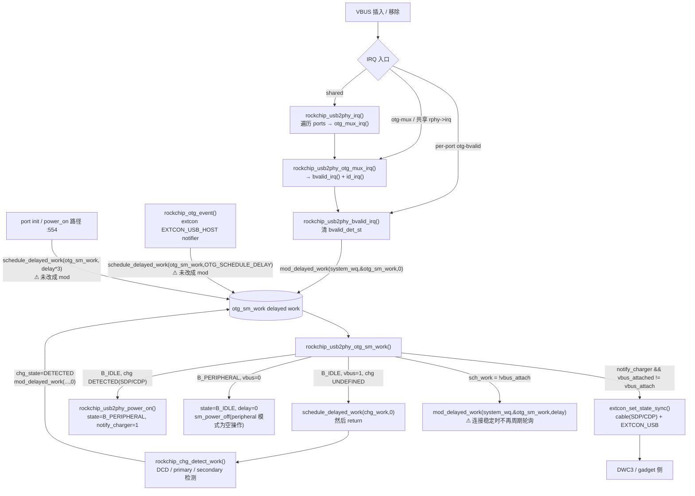
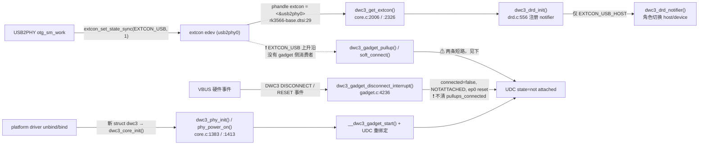

# RG353PS USB 重连故障：DWC3 / USB2PHY 内核审查

审查日期：2026-11-05
审查性质：**只读代码审查 + 证据汇总**。本轮没有修改内核、没有改 supervisor、没有改 DHCP / VBUS / Mass Storage 配置、没有提交 Git commit、没有触发 Release 构建。
交付后停止操作。

---

## 0. 基线与取证方式

| 项 | 值 |
|---|---|
| 仓库 | `https://github.com/dengzhan007/BaseOS-RG353PS` |
| 分支 | `main` |
| **远程 HEAD** | **`507004ee49d12ac7088ad4110afa97f43e77612b`** |
| 本地工作区 | `F:\workspace\2026-10-28-22-11-37\srcwork\baseos-my355`，HEAD `2728457`，**`git status` 干净，无用户未提交修改** |
| 本地与远程差异 | 本地停在 1.2.3（1.2.3 文档提交），远程已是 **1.2.4**。审查全部使用远程 `507004e` 的源码快照，未覆盖本地工作区 |
| 远程源码快照 | `.tmp-doc/main-review/BaseOS-RG353PS-main/`（经 `codeload` 取 `main` tarball 解压） |
| **候选内核版本** | **`bvalid-otg-sm-serialized-v1`**，见 `build-kernel.sh:2537` 的 `kernel-build.json` 字段 `usb_reconnect_kernel_revision`。仓库内无对应 tag，此标识来自构建脚本，不是 Git tag |
| 内核源码 | Linux `7.2.7`，来自 `work/rg353ps/kernel/linux-7.2.7.tar.xz`（pristine）与 `work/rg353ps/kernel/src/linux-7.2.7/`（11-01 已改写副本） |
| 硬件事实 | 2 主机 × 2 良好线共 40 轮；本工作区另有电脑 B 的 20 轮完整 CSV/JSON 与设备侧日志（`USB-Reconnect-Matrix/`） |

**取证方法**：`build-kernel.sh` 有 2553 行，大量内核改动是**嵌入式 Python 文本改写**，不是 patch 文件。为不靠推断，我从 pristine tarball 取出 `phy-rockchip-inno-usb2.c`，把脚本里 7 个与该文件相关的 `PYCODE` 块按顺序在独立副本 `.tmp-doc/phytest/` 上重放（6 个成功，1 个因缺 `storage_common.h` 失败，与 PHY 调用图无关）；再手工补跑日志降级逻辑。下文的调用图以**重放后的源码**为准，行号引自该副本，并同时标注本地 11-01 源码树的对应位置。

已确认的硬件事实（不重复测试）：40/40 最终恢复 RNDIS 与 MTP；19/40 需 supervisor re-probe（A 机 13/20、B 机 6/20）；B 机 1 次 Windows 落 APIPA 且该轮设备侧 dnsmasq 无请求；`soft_connect` 一次实测无效；键盘线曾卡 `default` 61.6 秒。

---

## 1. USB2PHY 状态机调用关系图



### 关键改写点（重放后源码）

| 位置 | 内容 | 作用与风险 |
|---|---|---|
| `:677` | 新增 `rockchip_usb2phy_sm_power_off()`，`USB_DR_MODE_PERIPHERAL` 时直接 return | peripheral 模式跳过 5 处 `power_off`，PHY 保持能检测 VBUS |
| `:765` | 删除 `if (rport->mode == USB_DR_MODE_PERIPHERAL) sch_work = true;` | **移除 B_IDLE 的 2 秒兜底轮询**，改为纯 IRQ 驱动 |
| `:767` | `if (rport->vbus_attached != vbus_attach)` → `if (notify_charger && rport->vbus_attached != vbus_attach)` | **只有 charger detection 完成才提交 VBUS 变化与 extcon 通知** |
| `:770` | extcon 通知块外包 `notify_charger && rphy->edev`，`EXTCON_USB` 由 SDP/CDP 决定 | 数据连接位与充电类型绑定 |
| `:802` | `sch_work = true` → `sch_work = !vbus_attach` | 连接稳定时不再自调度 |
| `:816` | `schedule_delayed_work` → `mod_delayed_work(system_wq, ...)` | 状态机内部重调度可前移已 pending 的 timer |
| `:941` / `:1106` | charger work 与 BVALID IRQ 的**直接 callback 调用** → `mod_delayed_work(...,0)` | 序列化两处直接执行 |
| `:554` / `:1335` | 仍是 `schedule_delayed_work(&rport->otg_sm_work, ...)` | **未覆盖**：见下 |

### 对第一阶段 6 个核实点的回答

1. **`mod_delayed_work` 是否覆盖所有直接执行状态机 callback 的路径** — 是。重放后 `rockchip_usb2phy_otg_sm_work(` 只剩函数定义与 `INIT_DELAYED_WORK`，两处直接调用已全部改为 `mod_delayed_work`。`otg_mux_irq()` 内部调用 `bvalid_irq()`，所以共享 IRQ / otg-mux 路径也被覆盖。
2. **是否仍有绕过统一 work item 的状态机执行入口** — **没有直接执行入口**，但还有 **2 处排队入口未统一**：`rockchip_otg_event()`（`:1335`，extcon HOST notifier）与 port init / power_on 路径（`:554`）仍用 `schedule_delayed_work`。它们排队同一个 work item，语义与 `mod_delayed_work` 不一致：`schedule_delayed_work` 无法把已 pending 的 timer 提前，在 VBUS 抖动时会把一次状态机运行推后。
3. **移除 B_IDLE 轮询后 IRQ 丢失是否导致永久不检查 VBUS** — **是，结构上存在这个可能**。删除轮询 + `sch_work = !vbus_attach` 之后，`B_IDLE` 且 `vbus=0` 时 `sch_work=false`，状态机**没有任何自调度**；唯一唤醒源是 BVALID IRQ（或 charger work 的回迁 / extcon HOST notifier）。若 IRQ 未 arm、在 suspend/resume 中被屏蔽、或 VBUS 边沿发生在 PHY 尚未重新 arm 的窗口，状态机就再也不会读 `utmi_bvalid`。`sm_power_off()` 在 peripheral 下为空操作，PHY 不掉电，这降低了风险但不等于 IRQ 一定在。
4. **BVALID IRQ / charger detection / extcon 更新是否有时序依赖** — **有，且是硬依赖**。B_IDLE 看到 `vbus=1` 时若 `chg_state=UNDEFINED`，会 `schedule_delayed_work(chg_work,0)` 后 **直接 return**；extcon 通知只发生在之后那次由 `rockchip_chg_detect_work()` 触发的状态机运行里，且要求 `notify_charger=1` 且 `vbus_attached` 仍是旧值。三者必须在同一轮里"对上"，否则 `vbus_attached` 与 `EXTCON_USB` 都不更新。
5. **suspend/resume、power-on/off、VBUS bounce 是否可能屏蔽 IRQ 或丢状态** — 源码里 `:657` 有 `cancel_delayed_work_sync(&rport->otg_sm_work)`；`rphy->irq > 0` 时 `port_irq_init()` 直接 return，跳过 per-port IRQ 注册（`:1210`）。这两处加上 `disable_usb_runtime_pm()`（把 `power/control` 写 `on`）共同改变了 IRQ/work 的生命周期。**尚无硬件日志证明**本轮发生过 IRQ 丢失，列为待验证。
6. **`EXTCON_USB=1` 时 PHY 是否已完成必要 init / power-on** — 不能直接等同。`extcon_set_state_sync()` 在 `:783` 被调用，而 `rockchip_usb2phy_power_on()` 在 `:731/:746` 的 SDP/CDP 分支里先执行；但 peripheral 模式下 `sm_power_off()` 空操作、`rport->suspended` 初值为 `true`（`:1352` 注释说明是刻意让 probe 阶段由控制器 power_on）。**PMIC charging 与 USB2PHY 数据连接是两条独立链路**，不能互相替代（脚本 `vbus_state()` 走 `/sys/class/power_supply/`，`extcon_summary()` 走 `/sys/class/extcon/`）。

---

## 2. PHY extcon → DWC3 gadget 的事件链



**关键源码事实**：

- `drd.c:556` 只注册 `EXTCON_USB_HOST` notifier；`EXTCON_USB`（peripheral 数据连接）**没有 DWC3 gadget 侧订阅者**。
- `dwc3_gadget_disconnect_interrupt()`（`gadget.c:4236-4268`）清 `dwc->connected`、`usb_gadget_set_state(NOTATTACHED)`、`dwc3_ep0_reset_state()`，但**不清 `dwc->pullups_connected`**，也不调用 `dwc3_gadget_run_stop(false)`。
- `dwc3_gadget_run_stop()`（`:2704`）是唯一设置 `pullups_connected` 的地方（`:2752` true / `:2756` false）。
- `dwc3_gadget_pullup()`（`:2877`）在 `is_on` 时：
  1. `:2910` `if (dwc->pullups_connected == is_on) return 0;` —— 拔线后该值仍为 true，**任何再次写 connect 都会被短路**；
  2. `:2902` `ret = pm_runtime_get_sync(); if (!ret || ret < 0) return ret;` —— **返回 0（设备已 active，没有发生 resume）时直接返回**。BaseOS 的 `disable_usb_runtime_pm()`（`baseos-usb-debug:199-204`）把 `power/control` 固定为 `on`，设备恒 active，因此这条捷径很可能恒成立。
- `dwc3_gadget_soft_connect()`（`:2858`）才会做 `dwc3_core_soft_reset()` + `dwc3_event_buffers_setup()` + `__dwc3_gadget_start()` + `run_stop(true)`，即真正的重连序列。
- `udc/core.c:707` 的 `usb_gadget_connect_locked()` 还有一道门：`gadget->deactivated || !udc->allow_connect || !udc->started` 时只置 `connected=true` 而不调用 `pullup()`。`soft_connect_store()`（`udc/core.c:1803`）的 `disconnect` 分支会 `usb_gadget_udc_stop_locked()`，因此 `connect` 时 `!udc->started` 可能成立 → **第二条短路**。

这三条源码事实共同解释了为什么「写 `soft_connect` disconnect/connect」实测 8 秒仍是 `not attached`，而 DWC3 re-probe 有效：re-probe 走的是 `dwc3_probe()` → `dwc3_core_init()` → `dwc3_phy_init()/phy_power_on()` → 全新 `struct dwc3`（`pullups_connected=false`）→ 重新绑定 UDC，完全绕开了 pullup 的短路判断。

---

## 3. DWC3 re-probe 实际执行步骤

`baseos-usb-debug` 里三种恢复动作的**实际区别**（不是按名字猜）：

| | 动作 | 实际做了什么 | 不做什么 |
|---|---|---|---|
| **A** | `rebind_gadget()` `:221` | 写空 `$G/UDC` 再写回 → configfs 重新把 gadget 绑到 UDC；必要时重建 `usb0` 与 DHCP | 不动 DWC3 平台设备、不动 PHY、不重新 probe |
| **B** | `reprobe_udc_driver()` `:245` | 解绑 gadget → `unbind` / `bind` `fcc00000.usb` 平台驱动 → **重新执行 `dwc3_probe()`**（含 `dwc3_get_extcon`、`dwc3_core_init` → `dwc3_phy_init`/`phy_power_on`、事件缓冲、IRQ、UDC 创建）→ 重新写 `$G/UDC` → `disable_usb_runtime_pm()` → 重建网络与 DHCP | 不重新 probe **USB2PHY provider**（PHY 只被 `phy_init/power_on` 重新初始化） |
| **C** | `reprobe_usb_stack()` `:289` | 在 B 之前额外 `unbind/bind` `rockchip-usb2phy` 平台设备，按冷启动顺序让 PHY 先带着 VBUS probe，再 probe DWC3 | 比 B 多一次 PHY 驱动重建与 extcon 设备重建 |

任务里「DWC3 re-probe 是否重新执行 Generic PHY init/power_on、IRQ 注册和 gadget connect」的答案是**是**：`core.c:1383` `dwc3_phy_init()` → `phy_init()`（`:837/:843`），`core.c:1413` `dwc3_phy_power_on()` → `phy_power_on()`（`:907/:913`）；remove 侧 `:997-998` 对应 `phy_power_off()` / `phy_exit()`。**但这不等于「PHY provider 必须重新 probe」**：B 只重跑 consumer 侧 PHY 调用就能恢复，C 才重建 provider。现有 40 轮数据里 supervisor 的 attempt 1/2 都是 B 且全部成功，说明 **B 已足够，C 不是必需**，因此不能从「re-probe 有效」推出「必须重置 PHY」。

LPM：`build-kernel.sh:613-649` 在 `rk3566-anbernic-rgxx3.dtsi` 的 `&usb_host0_xhci` 加 `snps,usb2-gadget-lpm-disable`。这是禁用 USB2 LPM/BOS 通告（`bcdUSB` 0x0201 → 0x0200），只影响描述符，不影响 re-probe 生命周期。`CONFIG_USB_DWC3_DUAL_ROLE=y`、DTS `extcon = <&usb2phy0>` 均已确认。

---

## 4. supervisor 状态判断与恢复阶梯

`watch_cable()`（`:540-637`），0.5 秒一 tick：

- 先算 `present`：`cable_present()`（`:116`）用**三个信号任一成立**：usb2phy 的 SDP/CDP cable 位、PMIC `vbus_state()=charging`、UDC `powered|configured`。注释明确 `attached` 不算。
- `present=no`：清空 `stuck_since`、`attempt=0`，**直接 continue**（不恢复）。
- `configured`：清空并 `ensure_link_up()`。
- **`default|address|powered`：`stuck_since=` —— 清空计时器，永不恢复**（`:595-596`）。键盘线 `default` 卡 61.6 秒正是此盲区；`powered` 也被当成健康态，属误判。
- 其它（含 `not attached`）：累计 `stuck_since`，连续 ≥4 tick（2 秒）且 `tick >= next_tick` 且无 `RECOVERY_LOCK` 时触发后台恢复；`next_tick = tick + 8` 节流。
- 阶梯（`:622-626`）：**attempt 1/2 → B（DWC3 re-probe）、attempt 3 → A（gadget rebind，反而更轻）、attempt 4+ → C（PHY + DWC3 全栈重建）**。第 3 级比第 2 级轻，顺序值得商榷，但本轮不改。
- 有 `mkdir` 锁与 `next_tick` 节流，恢复在后台运行；拔线/插线边沿会重置 `attempt`。**重复触发**被锁挡住，但 supervisor 在恢复期间仍每 0.5 秒读状态，恢复动作本身会短暂让 UDC 消失，日志里会出现状态抖动（B 组日志可见 `cable removed/inserted` 与 recovery 交错的记录）。
- **「有 VBUS 但无 extcon USB 数据连接」**是真实缺口：`cable_present()` 允许仅凭 PMIC charging 判为有线，但恢复阶梯只重建 DWC3 / gadget，不修复 PHY 状态机里的 `notify_charger` 门控或丢失的 IRQ 边沿。

---

## 5. 当前动态调试可用日志清单

内核配置已确认 `CONFIG_DYNAMIC_DEBUG=y`、`CONFIG_DYNAMIC_DEBUG_CORE=y`、`CONFIG_JUMP_LABEL=y`、`CONFIG_DEBUG_FS=y`（`linux.aarch64.conf:6705-6706, 659, 6743`）。

`build-kernel.sh:2320-2394` 的 `rg353ps_debug_only()` 把 4 个文件里**格式串以 `RG353PS` 开头**的 `dev_info()` → `dev_dbg()`、`pr_info()` → `pr_debug()`。副本重放 + 手工降级后，PHY 文件 14 条调用全部为 `dev_dbg`，0 条残留 `dev_info`。

| 文件 | 可用的低频日志（格式串前缀） | 级别 |
|---|---|---|
| `phy-rockchip-inno-usb2.c` | `RG353PS BVALID IRQ entry: ...`、`RG353PS USB PHY VBUS-valid IRQ observed`、`RG353PS OTG state-machine entry`、`RG353PS USB PHY OTG sample: ...`、`RG353PS OTG VBUS decision: ...`、`RG353PS extcon notify before/after: ...`、`RG353PS extcon charger/data result: ...`、`RG353PS BVALID IRQ request: ...`、`RG353PS shared PHY IRQ entry: ...`、`RG353PS port IRQ init...`、`RG353PS PHY probe entry` | `dev_dbg` |
| `gadget.c` | `RG353PS DWC3 device DISCONNECT event ...`、`RG353PS DWC3 device RESET event ...`、`RG353PS DWC3 device-event raw=...` | `dev_dbg` |
| `ep0.c` | `RG353PS EP0 SETUP type=...` | `dev_dbg` |
| `ep0.c` | `RG353PS ignoring stale EP0 ...`（2 条） | **`dev_warn_ratelimited`，常开，不受 dynamic_debug 控制**（仅在异常时触发） |
| `gadget.c:4021` | `RG353PS DWC3 bulk-out event epnum=...`(短版) | **`dev_info_ratelimited`，常开，高频** |

**两个必须指出的偏差**：

1. `build-kernel.sh:2331-2333` 注释里建议的 `echo "file gadget.c +p"` / `"file ep0.c +p"` **不符合本轮要求**：会打开 gadget.c 里全部 `dev_dbg`，包括 `RG353PS EP2 REQMAP` / `DEPCMD` / `bulk-out event` 这类每包数条的高频日志，1 MB dmesg 环缓冲几秒就被填满（该注释自己也描述了这件事）。**不要照抄**。
2. `rg353ps_debug_only()` 只精确匹配函数名 `dev_info` / `pr_info`，**不匹配 `dev_info_ratelimited` / `dev_warn_ratelimited`**。因此 `gadget.c:4021` 那条 bulk-out 日志在动态调试关闭时仍会打印（虽有 ratelimit）。这是「关闭时不能产生明显性能影响」的唯一已知例外，需要在诊断时留意，后续若要彻底门控应单独处理（本轮不改）。

---

## 6. 三层故障分级

### A 层：PHY / IRQ / OTG state machine

- **源码证据**：删除 B_IDLE 轮询（`:765`）、`sch_work = !vbus_attach`（`:802`）、`notify_charger &&` 门控（`:767`）、2 处 `schedule_delayed_work` 未序列化（`:554`、`:1335`）、共享 IRQ 时跳过 per-port 注册（`:1210`）、`cancel_delayed_work_sync`（`:657`）。
- **硬件证据**：re-probe 比例随主机变化（A 65% / B 30%）；B 组每次 `extcon USB=0↔1`、`vbus idle↔charging` 都正确翻转；B 组第 3 轮等 5 轮出现「插入时 `not attached`」；BVALID IRQ 没有内核打点，无法直接计数。
- **尚缺证据**：每次插回的 BVALID IRQ entry/pending、`utmi_bvalid` 采样值、charger detection 是否在同一轮完成、`vbus_attached` 是否真的在插入边沿被提交。
- **最小可验证修改**：不改状态机，只开 A 层动态调试日志（见 §8），确认「IRQ 是否触发」与「notify_charger 门控是否吞掉边沿」。
- **副作用 / 回滚**：仅日志开关，`-p` 即可回滚，无代码改动。

### B 层：PHY extcon → DWC3 session / connect 通知

- **源码证据**：`drd.c:556` 只订阅 `EXTCON_USB_HOST`；`EXTCON_USB` 上升沿没有 gadget 侧消费者；`core.c:2326` 确实取得 edev 但只用于角色切换。
- **硬件证据**：extcon 每次正确翻转，DWC3 仍停在 `not attached`；re-probe（重新 `phy_init/power_on` + 重建 gadget）100% 恢复；设备恢复慢 9 秒时主机 DHCP 落 APIPA。
- **尚缺证据**：extcon `EXTCON_USB=1` 的时刻与 DWC3 device event / `pullups_connected` / `dwc->connected` 的对应关系。
- **最小可验证修改**：给 `EXTCON_USB` 加一个**只读观测** notifier（或先用 §8 日志对照时间戳），不触发任何动作。
- **副作用 / 回滚**：观测回调无副作用；若以后改成触发动作，需评估与 supervisor re-probe 的并发。

### C 层：DWC3 gadget pullup / EP0 枚举

- **源码证据**：`dwc3_gadget_disconnect_interrupt()` 不清 `pullups_connected`（`:4236`）；`dwc3_gadget_pullup()` 的两条短路（`:2902` `pm_runtime_get_sync()==0`、`:2910` `pullups_connected==is_on`）；`udc/core.c:720` 的 `!udc->started` 短路；`dwc3_gadget_soft_connect()` 才是真正重连序列（`:2858`）。
- **硬件证据**：`soft_connect` disconnect/connect 写入成功但 8 秒仍 `not attached`，`speed=UNKNOWN`；键盘线曾停在 `default` 61.6 秒（EP0 Get Descriptor 阶段）。
- **尚缺证据**：`soft_connect` 写入时 `dwc3_gadget_pullup()` 是否真的被调用、在哪一条短路返回；`pm_runtime_get_sync()` 的实际返回值；`udc->started` 状态。
- **最小可验证修改**：在 `dwc3_gadget_pullup()` 入口/两条 return 处加 3 条 `dev_dbg`（不改逻辑），或在 §8 里读 `/sys/class/udc/*/state` + `soft_connect` 前后快照。
- **副作用 / 回滚**：纯日志，回滚即删。

---

## 7. 最可能的三个故障位置（按证据强弱排序）

1. **【最强】C/B 交界：`EXTCON_USB` 上升沿没有任何路径让 DWC3 重新执行 `dwc3_gadget_soft_connect()`。**
   证据链最完整：extcon 每次都对、`drd.c` 只听 HOST、disconnect interrupt 不清 `pullups_connected`、`pullup()` 有两条实测会命中的短路、re-probe 通过重建对象绕过它们。这也解释了为什么「比 pullup 更重」的 re-probe 是唯一有效手段，以及为什么 soft_connect 单独写无效。
2. **【中】A 层：`notify_charger &&` 门控 + 移除 B_IDLE 轮询后，状态机过度依赖「一次 IRQ + 一次 charger detection 配对成功」。**
   能解释 re-probe 需求随主机/时序变化（30% vs 65%），以及为什么重新 probe（带着已存在的 VBUS 走一遍完整 charger detection）总能恢复。但缺 BVALID IRQ 逐次日志，**尚未证实**。
3. **【弱】C 层 EP0 枚举：`default` 卡死。**
   只在键盘线（信号完整性差）上出现 61.6 秒，良好线 40 轮未复现。属于独立盲区，不应与内核重连修复混为一个实验。

---

## 8. 最小诊断方案（只读，不改任何参数）

原则：只启用**明确匹配的格式字符串/函数**，不开整个 `gadget.c`；日志落到 `/mnt/SDCARD`；不改 USB 参数、DHCP、Runtime PM、supervisor。

```sh
# 1. 挂 debugfs（只挂载，不改参数）
mount -t debugfs none /sys/kernel/debug 2>/dev/null || :
C=/sys/kernel/debug/dynamic_debug/control

# 2. PHY 侧：整个文件都是低频日志，可以整开
echo 'file phy-rockchip-inno-usb2.c +p' > "$C"

# 3. DWC3 侧：只开三条事件日志，避开 EP2 高频
echo 'format "RG353PS DWC3 device DISCONNECT event" +p' > "$C"
echo 'format "RG353PS DWC3 device RESET event" +p' > "$C"
echo 'format "RG353PS DWC3 device-event raw" +p' > "$C"
echo 'format "RG353PS EP0 SETUP" +p' > "$C"

# 4. 确认只开了想要的那几条（应看到 10 余条，不是几百条）
grep 'RG353PS' "$C" | grep '=p' | wc -l

# 5. 一轮拔插，然后立刻采集到卡上（重启不丢）
OUT=/mnt/SDCARD/usb-reconnect-diag-$(date +%Y%m%d-%H%M%S).log
{
  date; cat /etc/baseos-release
  echo "--- UDC ---"
  for u in /sys/class/udc/*; do echo "$u state=$(cat "$u/state") speed=$(cat "$u/current_speed")"; done
  echo "--- extcon ---"
  for e in /sys/class/extcon/*; do echo "$e: $(cat "$e/state")"; done
  echo "--- dmesg ---"
  dmesg | grep -E 'RG353PS|dwc3|usb2phy|extcon' | tail -n 300
} > "$OUT" 2>&1
sync

# 6. 关掉（诊断结束必须执行）
echo 'file phy-rockchip-inno-usb2.c -p' > "$C"
echo 'format "RG353PS DWC3 device DISCONNECT event" -p' > "$C"
echo 'format "RG353PS DWC3 device RESET event" -p' > "$C"
echo 'format "RG353PS DWC3 device-event raw" -p' > "$C"
echo 'format "RG353PS EP0 SETUP" -p' > "$C"
```

**注意**：`gadget.c:4021` 那条 `dev_info_ratelimited` 不受上述开关控制，会一直打印；采集时若 dmesg 被它淹没，用 `grep -v 'bulk-out event'` 过滤即可，不要用 `file gadget.c +p`。

判读顺序（对应 `USB.md:171-183`）：① BVALID IRQ entry 是否出现、`pending` 是否为 1 → ② OTG state-machine entry 与 `OTG sample bvalid` → ③ `OTG VBUS decision` 的 `notify` 与 `old/new` → ④ `extcon notify before/after` 的 `usb=` → ⑤ DWC3 是否出现 DISCONNECT/RESET/device-event raw → ⑥ UDC `state` 与 `current_speed`。

**最需要的一条对照**：把 `extcon USB=1` 的时间戳与随后 5 秒内 DWC3 的 device event 对齐。如果 extcon 翻了而 DWC3 一条事件都没有，第 1 号根因成立。

---

## 9. 最小修复候选与回滚

| 优先级 | 落点 | 候选修改 | 副作用 | 回滚 |
|---|---|---|---|---|
| 诊断先行（本轮不做） | 无 | 只跑 §8 | 无 | 关 `-p` |
| **下一轮最小改动** | **`drivers/usb/dwc3/gadget.c` → `dwc3_gadget_disconnect_interrupt()`** | 断开时把 `dwc->pullups_connected` 置 `false`（或置一个 `needs_soft_connect` 标志），使后续任何 `pullup(1)` 不再被 `:2910` 短路，能真正走 `dwc3_gadget_soft_connect()` | 主机正常 reset 也可能多一次 core soft reset；`dwc3_gadget_soft_connect()` 本身就是为「device-initiated disconnect 后重连」设计的，风险可控 | 删掉这一行，重新编译内核；不影响 rootfs / supervisor |
| 配套（若上一条仍不够） | `gadget.c` → `dwc3_gadget_pullup()` | 把 `:2902` 的 `if (!ret || ret < 0)` 改成只在「确实发生了 runtime resume」时跳过，避免 `power/control=on` 配置下 pullup 变成 no-op | 可能与上游 runtime PM 假设冲突，必须先在诊断中确认 `pm_runtime_get_sync()` 返回值 | 同上 |
| 备选（更靠近根因但更大） | `core.c` / `drd.c` | 为 `EXTCON_USB` 注册 notifier，回调里执行受限重连（`dwc3_gadget_soft_connect()`，必要时 `dwc3_phy_init/power_on`），不动 platform driver 绑定 | 可能与 supervisor 的 re-probe 并发，需要锁；影响面比上两条大 | 注销 notifier |
| **不建议** | PHY provider | unbind/bind `rockchip-usb2phy` 或强制 PHY reset | 重建 extcon 设备、charger 状态、IRQ，且 40 轮数据表明 supervisor 的 attempt 1/2（只重 probe DWC3）已 100% 恢复，**没有证据表明 provider 必须重建** | 需重启 |

**`default` / `address` 超时恢复必须作为独立实验**：只改 `baseos-usb-debug` 的 `case default|address|powered)` 分支（把 `stuck_since=` 改为与 `*` 分支同样的计时），与内核重连修复分开提交、分开验证。二者失败形态不同（键盘线信号完整性 vs VBUS 恢复后不枚举），混在一起会无法归因。

**B_IDLE watchdog 评估**：不建议直接恢复固定 2 秒轮询。当前证据只说明「移除轮询后唤醒源变单一」，没有证明 IRQ 真的丢失；轮询有持续功耗成本，`USB.md:193` 也要求先测 idle power。更合理的顺序是：先用 §8 确认 BVALID IRQ 触发率；**只有确认存在 IRQ 丢失**时，才考虑**有界**的低频 watchdog（例如仅在 `B_IDLE && rport->suspended==false && 距上次 IRQ 超过 N 秒`时补一次采样），并单独测 idle 电流。

---

## 10. 尚未证实的推测（明确标注）

1. **`pm_runtime_get_sync()` 在 `power/control=on` 下返回 0，导致 `dwc3_gadget_pullup()` 恒短路** —— 源码逻辑与配置都指向这个结论，但**没有运行时返回值证据**，需 §8  diagnostics 或加一条临时日志确认。
2. **`notify_charger &&` 门控会在 VBUS 抖动时吞掉边沿** —— 代码结构支持，但 B 组 20 轮 extcon 每次都正确翻转，**没有观测到被吞的实例**。
3. **共享 IRQ 路径或 suspend/resume 会屏蔽 BVALID IRQ** —— DTS 的 `rphy->irq` 配置与运行时 IRQ 计数未取到，属推测。
4. **键盘线 `default` 卡死会在良好线上偶尔复现** —— 40 轮良好线 0 次，纯推测。
5. **`stuck-at-default` 与 `not attached` 是同一个根因** —— 现有证据表明是两个独立盲区，不应合并。
6. 候选名 `bvalid-otg-sm-serialized-v1` 对应的**具体构建产物是否与设备上 1.2.4 / `67f86b1` 完全一致**未在本仓库验证；本报告只确认了构建脚本里的源码改写内容。

---

## 11. 停止声明

本轮到此为止：**未修改任何内核状态机、未添加 PHY reset、未改 VBUS 检测、未改 DHCP、未改 supervisor 恢复阶梯、未改 Mass Storage、未提交 Git commit、未触发 Release 构建**。唯一新增的文件是本报告。
